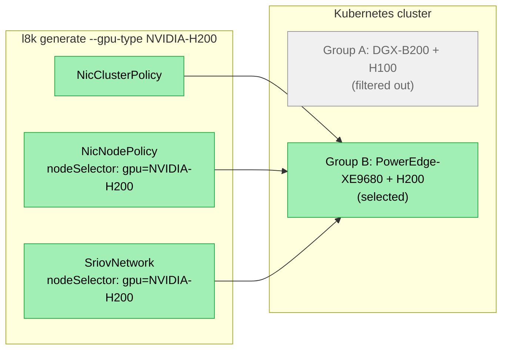
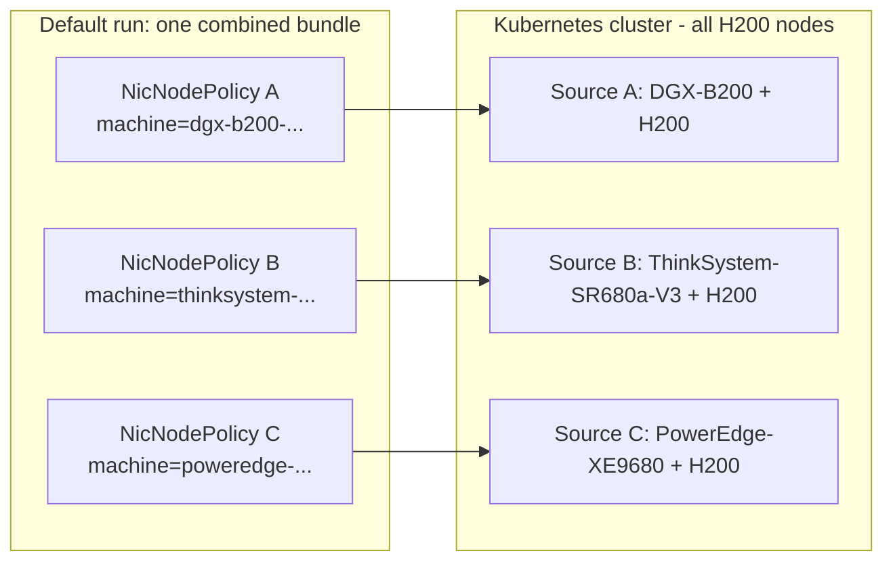
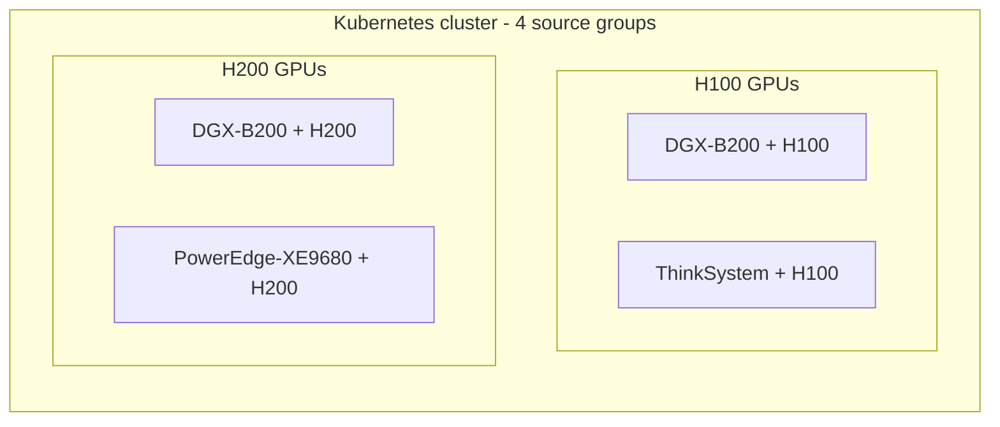
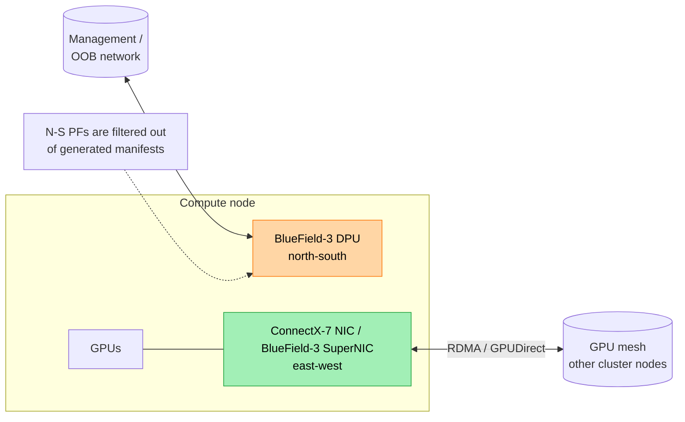

{/*
  SPDX-FileCopyrightText: Copyright (c) 2025 NVIDIA CORPORATION & AFFILIATES. All rights reserved.
  SPDX-License-Identifier: Apache-2.0
*/}

<Note>
**Use this when:** your cluster contains multiple node types --- e.g., different GPU SKUs (H100 + H200), different NIC SKUs (ConnectX-7 NIC + BlueField-3 SuperNIC), or different OFED requirements.
</Note>

## Supported Configurations

Each configuration shows a discovered cluster shape, the `l8k generate` invocation, and which manifests get rendered.

Two Groups, Different GPUs (`--gpu-type`)

### Two Groups, Different GPUs (`--gpu-type`)

A cluster with two GPU types --- H100 and H200, each on its own server SKU. `--gpu-type` filters generation to a single GPU type so a manifest set lands on exactly that subset.



```bash
l8k generate --user-config ./cluster-config.yaml \
    --gpu-type NVIDIA-H200 \
    --fabric ethernet --deployment-type sriov --multirail \
    --save-deployment-files ./deployments-h200
```

Drop `--gpu-type` to render manifests covering **both** GPU types: the generator emits a separate per-GPU bundle (each with its own `NicNodePolicy`, `SriovNetworkNodePolicy`, and `SriovNetwork`) keyed off the `nvidia.kubernetes-launch-kit.gpu` label. The single `NicClusterPolicy` is shared.

Three Groups, Same GPU, Different Servers (`--groups`)

### Three Groups, Same GPU, Different Servers (`--groups`)

A cluster with three server SKUs all running H200s. Discovery places them in three source groups (one per machineType). They are auto-combined at generation time into a single bundle (see [Strategy 1 --- Automatic Combination at Generation](/k8s-launch-kit/heterogeneous-clusters#strategy-1-----automatic-combination-at-generation) below). `--groups` narrows the cohort when you need a staged rollout.

The diagram shows the per-source `NicNodePolicy` pairing — each NodePolicy carries its source group's `machine` label and targets exactly its source's nodes. `NicClusterPolicy`, `IPPool`, and `SriovNetwork` are bucket-shared (one CR each, covering all three sources) and are described in the prose below.



```bash
# Default: covers all three source groups (auto-combined into one bundle)
l8k generate --user-config ./cluster-config.yaml \
    --fabric ethernet --deployment-type sriov --multirail \
    --save-deployment-files ./deployments

# Staged rollout: deploy to two of three first
l8k generate --user-config ./cluster-config.yaml \
    --groups dgx-b200-nvidia-h200,thinksystem-sr680a-v3-nvidia-h200 \
    --fabric ethernet --deployment-type sriov --multirail \
    --save-deployment-files ./deployments-stage1
```

Same GPU + identical east-west rail count = one bucket. Per-source `NicNodePolicy` CRs use the `nvidia.kubernetes-launch-kit.machine` label; the bucket-level `IPPool` uses an `In` selector over the source labels (or the shared `.gpu` label when not filtered). The `SriovNetwork` references a single shared `resourceName` that all three NodePolicies register, so any pod scheduled on any of the six nodes gets a VF.

Mixed Cluster (`--gpu-type` and `--groups` Together)

### Mixed Cluster (`--gpu-type` and `--groups` Together)

A real-world cluster: two GPU types, multiple server SKUs per type. Discovery produces four source groups arranged as a 2×2 grid (GPU type × machine type). The three commands below show the three common ways to scope a generation.



```bash
# Default: render everything. Two render buckets (H100, H200), each with
# per-source NicNodePolicy CRs and a bucket-level SriovNetwork/IPPool.
l8k generate --user-config ./cluster-config.yaml \
    --fabric ethernet --deployment-type sriov --multirail \
    --save-deployment-files ./deployments-all

# Just H200 nodes across both vendors -> selects G3 and G4
l8k generate --user-config ./cluster-config.yaml \
    --gpu-type NVIDIA-H200 \
    --fabric ethernet --deployment-type sriov --multirail \
    --save-deployment-files ./deployments-h200-only

# Just DGX-B200 nodes (one source from each GPU type) -> selects G1 and G3.
# Strict subset: per-source NodePolicies use machine labels; bucket-level
# CRs use In: [machine-label-h100-dgx, machine-label-h200-dgx].
l8k generate --user-config ./cluster-config.yaml \
    --groups dgx-b200-nvidia-h100,dgx-b200-nvidia-h200 \
    --fabric ethernet --deployment-type sriov --multirail \
    --save-deployment-files ./deployments-dgx-only
```

The default run is the common path. Use `--gpu-type` when "all nodes of GPU X" is the deployment unit. Use `--groups` when the cohort is enumerated explicitly --- e.g., a vendor-specific rollout, or a CI matrix where each cell pins a fixed set of identifiers.

## Discovery: Initial Grouping by PCI Topology

`l8k discover` places nodes into groups by their PCI topology --- the set of PCI addresses and device IDs across each node's PFs. Nodes with identical PCI topology land in the same group. Each group carries:

- `machineType` and `gpuType` (e.g., `ThinkSystem-SR680a-V3` / `NVIDIA-H100-NVL`), populated from GPU operator labels or probed from hardware.
- A machine label written to every node in the group: `nvidia.kubernetes-launch-kit.machine: <machineType>-<gpuType>` (sanitised — lowercase, spaces and slashes replaced with hyphens).
- An `identifier` equal to the sanitised label value (e.g., `thinksystem-sr680a-v3-nvidia-h100-nvl`). When `machineType` or `gpuType` couldn't be resolved, a fallback `group-N` identifier is used and the label is **not** written.
- A `nodeSelector` keyed by the same label: `{nvidia.kubernetes-launch-kit.machine: <value>}`. This is the per-source-group selector — selecting on it picks exactly the nodes in that one group, even when several groups share a GPU type.
- The list of east-west PFs with their `rail` indices.

The resulting groups are written to `cluster-config.yaml` as separate entries. From there you have two strategies for handling more than one group.

<Note>
The label is l8k state, not GPU operator state. Discovery patches each node with a strategic-merge `client.RawPatch` after the group's `machineType` and `gpuType` are determined. Migrated configs (loaded with old-style differential nodeSelectors from previous l8k versions) keep working unchanged --- the label is only written on a fresh discovery run.
</Note>

## Strategy 1 --- Automatic Combination at Generation

The groups in `cluster-config.yaml` stay separate --- they're written as distinct entries with their own machine-label `identifier`, `nodeSelector`, and PF lists. When `l8k generate` runs, groups that share the same **GPU product type** *and* the same **east-west rail count** are automatically combined into a single render group at generation time:

- The combined render group's `identifier` follows the resource-name convention (lowercase form of the gpuType, e.g., `nvidia-h100-nvl`). Source machine-labels can differ across the merged groups, so a single per-source label can't represent the merged set.
- Its effective `nodeSelector` becomes `{nvidia.kubernetes-launch-kit.gpu: <gpuType>}` --- targeting every node of that GPU type, regardless of source machine type. The `.gpu` label is also written by `l8k discover` (alongside the per-source `.machine` label), and its value matches `nvidia.com/gpu.product` verbatim by construction.
- `workerNodes` and OFED-dependent module lists are taken as the union of the source groups.
- One set of manifests is produced that covers all source groups with that GPU type.

The source groups in `cluster-config.yaml` are not mutated; the combination happens in memory while rendering. This is the right strategy when your cluster has multiple node SKUs with the same GPU product type (e.g., two server vendors both running H100s) --- the generator produces a single deployment driven by the GPU product label.

When source groups share a GPU type but have **conflicting PCI topologies** (the same PCI address appears at different rail positions across source groups, or rail-to-PCI mappings differ), the generator deploys `NicInterfaceNameTemplate` CRs to normalize interface names via udev rules. Pods then reference rail-stable names (e.g., `rdma_r0`, `eth_r1`) instead of PCI addresses, so a single manifest set works across all source groups despite the underlying PCI differences. See [NIC Interface Name Templates](/k8s-launch-kit/heterogeneous-clusters#nic-interface-name-templates) below.

Combination happens automatically with no flags required. Groups with different GPU types remain separate; groups without a discoverable GPU type are never combined.

## Strategy 2 --- Separate Configs per Group

Use this strategy when groups need genuinely different configurations --- different Network Operator releases, different fabric, different deployment types, different DOCA driver versions, or different profile selections.

A single `l8k generate` invocation produces one set of manifests with one Network Operator version, one fabric, one deployment type, etc. To deploy different configs to different groups, run `l8k generate` separately for each group (or compatible subset) with `--groups <comma-separated-identifiers>` and a distinct output directory:

```bash
# First group: SR-IOV Ethernet on Network Operator 26.4
l8k generate --user-config ./cluster-config.yaml \
    --groups dgx-b200-nvidia-h100-nvl \
    --network-operator-release 26.4 \
    --fabric ethernet --deployment-type sriov --multirail \
    --save-deployment-files ./deployments-h100

# Second group: Host Device on Network Operator 26.1
l8k generate --user-config ./cluster-config.yaml \
    --groups poweredge-xe9680-nvidia-h200 \
    --network-operator-release 26.1 \
    --deployment-type host_device --multirail \
    --save-deployment-files ./deployments-h200
```

Each run produces an independent manifest set scoped to its source groups' `nodeSelector`. The two sets can be applied to the same cluster --- they target disjoint nodes.

`--groups` accepts a comma-separated list of source-group identifiers (`--groups a,b,c`); identifiers come from `cluster-config.yaml`'s `clusterConfig[].identifier`. Match is case-sensitive; an empty match is a validation error.

## Strategy 3 --- Filter by GPU Type

For declarative pipelines and CI/CD, `--gpu-type <X>` filters source groups by their `gpuType` (matched case-insensitively):

```bash
l8k generate --user-config ./cluster-config.yaml \
    --gpu-type NVIDIA-H200 \
    --fabric ethernet --deployment-type sriov --multirail \
    --save-deployment-files ./deployments-h200
```

`--gpu-type` and `--groups` are mutually exclusive. `--gpu-type` is the right choice when "deploy this manifest to every node of GPU type X regardless of vendor" is the intent. `--groups` is the right choice when the cohort of source groups must be enumerated explicitly.

## What Renders Per Group vs. Per Bucket Under Filter

When `--groups` selects a strict subset of a compatible (gpuType, rail-count) bucket, l8k cannot use a single flat `nodeSelector` to identify exactly that subset (the bucket-level GPU label would over-select). The renderer dispatches each Kubernetes Kind by scope:

| **Scope** | **Behaviour under a strict-subset `--groups` filter** |
| --- | --- |
| Cluster-wide (`NicClusterPolicy`) | One CR per cluster, unchanged. |
| Aggregate (`IPPool`, example `DaemonSet`) | One CR per bucket. `nodeSelectorTerms` emits `In: [machine-label-a, machine-label-b]` covering exactly the filtered sources. |
| Bucketed (`SriovNetwork`, `CIDRPool`, `HostDeviceNetwork`, `IPoIBNetwork`, `MacvlanNetwork`, `OVSNetwork`) | One CR per bucket, named with the merged-bucket identifier. No node selector --- referenced by name from companion CRs and bound to nodes via the kubelet resource that the per-source NodePolicies register. |
| Simple-selector (`NicNodePolicy`, `SriovNetworkNodePolicy`, `SriovNetworkPoolConfig`, `SpectrumXRailPoolConfig`, `NicConfigurationTemplate`) | One CR per filtered source group, each with its own machine-label flat `nodeSelector`. All N CRs register the same bucket-shared kubelet resource so the Bucketed companions can reference one stable name. |
| Per-source (`NicInterfaceNameTemplate`) | One CR per source group, always (regardless of merge or filter). PCI addresses are machine-specific and never aggregate. |

For default unfiltered runs and `--gpu-type` runs, every bucket selects exactly its full source set, so the Aggregate and Simple-selector CRs render once per bucket against a single flat `nodeSelector` keyed by the bucket's GPU label.

## Per-Group Manifest Layout

Within a single `l8k generate` run, manifests split between cluster-wide and per-group resources:

- `10-nicclusterpolicy.yaml` --- cluster-wide components (Multus, CNI plugins, NV-IPAM, NIC Configuration Operator, Spectrum-X Operator). Rendered once.
- `11-nicnodepolicy.yaml` --- per-group components (OFED driver, device plugins). Rendered once per group with that group's `nodeSelector`.
- `30-*.yaml` --- network resources, per-group when needed (e.g., `30-sriovnetworknodepolicy-group-0.yaml`).

The per-group split ensures node selectors are correctly scoped within a single deployment. `imagePullSecrets` set on the NicClusterPolicy propagate into per-group NicNodePolicy sub-specs.

This is a packaging mechanism inside one config --- not a way to deploy different driver versions per group. To vary the OFED driver, Network Operator release, or fabric across groups, use Strategy 2.

The deployment ordering ensures dependency resolution: NicClusterPolicy first (wait for readiness), then each NicNodePolicy (wait for readiness), then the remaining manifests.

## NIC Interface Name Templates

`NicInterfaceNameTemplate` CRs rename NIC interfaces to predictable, rail-based names using udev rules. Launch Kit deploys them by default for **every** profile and every cluster shape --- not only when PCI addresses are ambiguous. The benefit is uniform interface names across server SKUs (`rdma_r0`, `eth_r1`, …): pod manifests, NetworkAttachmentDefinitions, and operator scripts can reference one stable name per rail regardless of which vendor chassis the pod lands on, and reboots that re-enumerate PCI no longer break selectors.

Naming conventions:

- Standard profiles: `rdma_r%rail%`, `eth_r%rail%` (e.g., `rdma_r0`, `eth_r1`).
- Spectrum-X profiles: `roce_p%plane%_r%rail%`, `eth_p%plane%_r%rail%` (e.g., `roce_p0_r2`).

To opt out and reference interfaces by their original PCI addresses instead, set `nicConfigurationOperator.deployNicInterfaceNameTemplate: false` in your `cluster-config.yaml` (or `l8k-config.yaml`). This is rarely needed --- the renamed names are a strict superset of what PCI selectors can express.

## North-South vs East-West Traffic

During discovery, each PF is classified by traffic direction:

- **East-west** --- GPU-to-GPU interconnect (ConnectX, BlueField-3 SuperNIC). Included in generated manifests and assigned a sequential `rail` index.
- **North-south** --- management or out-of-band (BlueField DPUs). Saved in `cluster-config.yaml` for visibility but **filtered out** of generated manifests.

The classification uses an embedded list of DPU product codes. BlueField-3 SuperNICs are explicitly classified as east-west even though they share a part-number prefix with BlueField DPUs. PFs that match no known east-west or north-south signature are treated as out-of-band and excluded from generated manifests.



## See Also

- [Overview](/k8s-launch-kit/overview) --- the node-group / fabric / traffic vocabulary
- [Discover Workflow](/k8s-launch-kit/workflows/discover) --- how groups are formed
- [Generate Workflow](/k8s-launch-kit/workflows/generate) --- `--group` flag in context
- [Configuration Reference](/k8s-launch-kit/reference/config) --- `clusterConfig` and `nicConfigurationOperator` schemas
