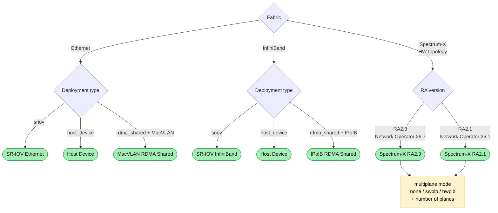

{/*
  SPDX-FileCopyrightText: Copyright (c) 2025 NVIDIA CORPORATION & AFFILIATES. All rights reserved.
  SPDX-License-Identifier: Apache-2.0
*/}

A **profile** is a named combination of fabric and deployment type. Each profile maps to a complete set of Kubernetes manifests produced by `l8k generate`. Pick a profile from the decision tree or table below, then follow the link.

For the conceptual difference between fabric and deployment type, see [Overview](/k8s-launch-kit/overview).

## Decision Tree

Fabric is determined by the underlying hardware topology (Spectrum-X clusters are detected as a distinct fabric, not as a flavour of Ethernet). Pick the deployment type for each fabric:

## Decision Matrix

| **Profile** | **When to use** | **Fabric / Deployment type** | **Keywords** |
| --- | --- | --- | --- |
| [SR-IOV Ethernet](/k8s-launch-kit/profiles/sriov-ethernet) | High-performance Ethernet networking with hardware acceleration. Per-pod dedicated VFs. | ethernet / sriov | SR-IOV, RDMA, low-latency, dedicated VFs |
| [SR-IOV InfiniBand](/k8s-launch-kit/profiles/sriov-infiniband) | Virtualized InfiniBand with hardware acceleration. Isolated IB partitions per pod. | infiniband / sriov | SR-IOV, InfiniBand, large-scale HPC |
| [Host Device](/k8s-launch-kit/profiles/host-device) | Direct hardware passthrough. Minimal CPU overhead. Exclusive device access per pod. | ethernet or infiniband / host_device | host-device, PCI-passthrough, DPDK |
| [IP over InfiniBand (RDMA Shared)](/k8s-launch-kit/profiles/ipoib-rdma-shared) | InfiniBand networking with shared RDMA resources. Parallel I/O workloads. | infiniband / rdma_shared | IPoIB, shared-device, high-bandwidth |
| [MacVLAN (RDMA Shared)](/k8s-launch-kit/profiles/macvlan-rdma-shared) | Multi-tenant Ethernet with shared RDMA capabilities and network isolation. | ethernet / rdma_shared | MacVLAN, multi-tenant, network-segmentation |
| [Spectrum-X](/k8s-launch-kit/profiles/spectrum-x) | NVIDIA Spectrum-X multi-rail AI interconnect (RA2.3, or RA2.1 for Network Operator 26.1). Single-plane, SWPLB, or HWPLB. | ethernet / sriov / spectrum-x | Spectrum-X, multiplane, RA2.3, HWPLB |

## See Also

- [Overview](/k8s-launch-kit/overview) --- profile selection vocabulary
- [Generate Workflow](/k8s-launch-kit/workflows/generate) --- how profile flags are consumed
- [Heterogeneous Clusters](/k8s-launch-kit/heterogeneous-clusters) --- mixing profiles per node group
